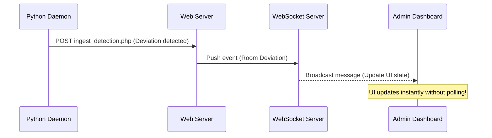

# S.P.O.T.-IT — Future Scaling & System Architecture Roadmap

This document serves as a systems engineering blueprint for scaling **S.P.O.T.-IT** from its current prototype state into a commercial-grade, multi-campus deployment. It outlines the specific concepts from modern cloud architecture and systems engineering that are directly applicable to the future roadmap of this system.

---

## 1. Real-Time Communication via WebSockets

- **Current Prototype:** **Short Polling**. The dashboard client queries the server every 2 seconds via `setInterval` and `fetch` requests. This generates constant MySQL `SELECT` requests even if no changes occur in the room.
- **Future Upgrade:** **WebSockets (Pusher / Socket.io / Native WebSockets)**.
- **How it works:** WebSockets establish a single persistent, bi-directional connection between the web client and the server.
- **Application to S.P.O.T.-IT:**
  - The moment the Python daemon detects a missing item, it sends a payload to the backend server.
  - The backend server pushes this event to the WebSocket server, which immediately triggers a UI update on the admin dashboard.
  - **Result:** Instant alerts (0ms delay) and a 90% reduction in server load.

---

Note: The 409/month plan of hostinger has 100 GB NVMe storage so consider if we really need this in the future

## 2. Cloud-Based Snapshot Storage (AWS S3)

- **Current Prototype:** **Local Storage**. Snapshot image files are saved directly in `uploads/snapshots/` under XAMPP / Hostinger server directories.
- **Future Upgrade:** **AWS S3 (Simple Storage Service) or Cloudflare R2**.
- **How it works:** Rather than saving photos on the web server's local hard drive (which has limited space), files are uploaded directly to an isolated, low-cost cloud storage vault.
- **Application to S.P.O.T.-IT:**
  - When `main.py` saves Snapshot A and Snapshot B, it uploads them to an S3 bucket using Python's `boto3` library and receives a secure, public URL.
  - The Python script posts that URL to `ingest_detection.php` which saves it in the database.
  - **Result:** Keeps the web app server light, fast, and ensures Hostinger storage limits are never exceeded regardless of how many months of logs are stored.

---

## 3. Asynchronous Event Queuing (RabbitMQ / Redis Queue)

- **Current Prototype:** **Synchronous API Ingestion**. When the Python daemon detects changes, it makes a direct POST request to `ingest_detection.php`. The PHP script locks the database, updates multiple tables, sends emails/notifications, and returns a response while the Python script waits.
- **Future Upgrade:** **Message Queue (Redis / RabbitMQ)**.
- **How it works:** Instead of executing database operations synchronously, ingestion requests are placed on a lightweight queue. A background worker pulls jobs off the queue and processes them in order.
- **Application to S.P.O.T.-IT:**
  - The Python daemon posts events to an API endpoint which immediately pushes them to the queue and returns `202 Accepted` (taking only milliseconds).
  - A background process handles database updates and email notifications asynchronously.
  - **Result:** Prevents script timeouts, protects the database from concurrent write locks, and ensures the Python video capture loop never lags.

---

## 4. DB Credentials Encryption & Vaulting

- **Current Prototype:** Camera passwords and IP configurations are stored in plain text in the `rooms` table for testing.
- **Future Upgrade:** **AES-256 Encryption & Environment Vaulting**.
- **How it works:** Sensitive camera credentials are encrypted in the database using a cryptographic key stored strictly in the server environment variables (`env.php` or AWS Secrets Manager).
- **Application to S.P.O.T.-IT:**
  - Admins enter Tapo passwords through the UI. The PHP backend encrypts them before saving to MySQL.
  - The Python daemon decrypts the credentials locally to build the RTSP stream string.
  - **Result:** Protects physical CCTV streams from unauthorized access if the database is ever compromised.

---

## 5. Deployment Containerization (Docker Staging)

- **Current Prototype:** Executing the script via local terminal commands (`python main.py`).
- **Future Upgrade:** **Docker Compose Multi-Container Orchestration**.
- **How it works:** Packaging both the Python engine and the PHP/Apache site into isolated containers that can be deployed as an installable package on CEAT servers.
- **Application to S.P.O.T.-IT:**
  - Build a multi-container environment where MySQL, Apache/PHP, and the Python daemon run side-by-side inside Docker.
  - **Result:** One-command deployment in any target CEAT server room without needing manual PHP or Python configuration setup.
